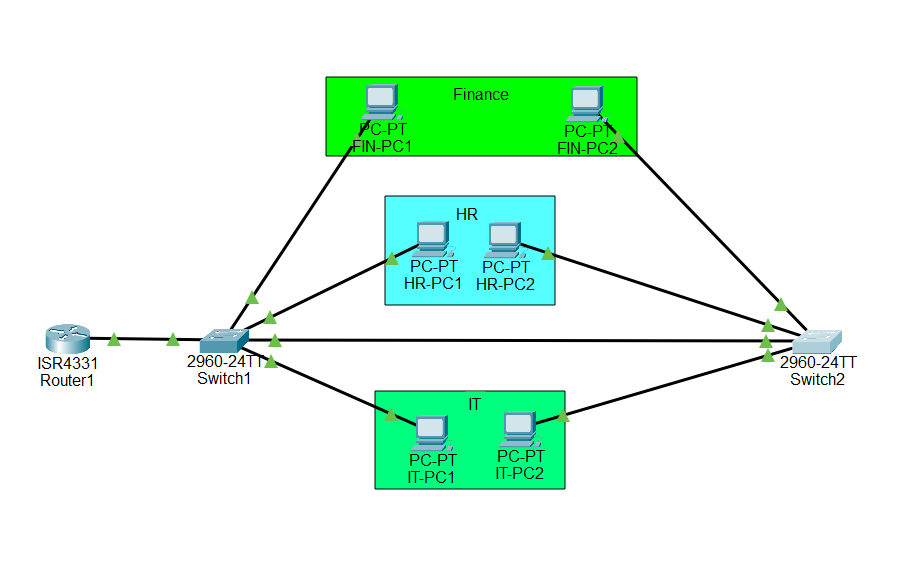
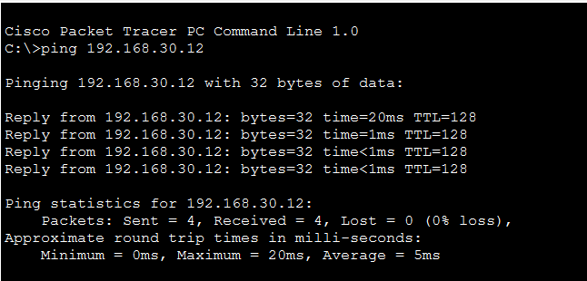
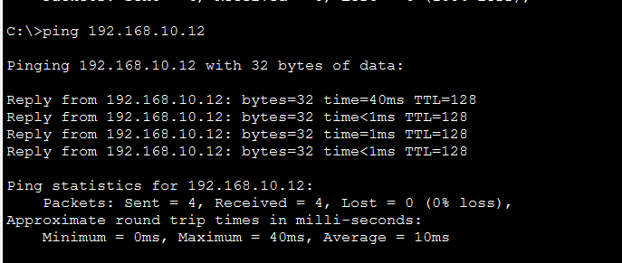
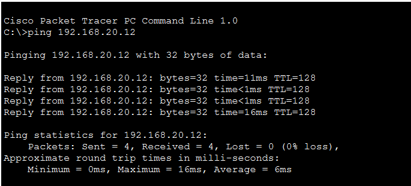
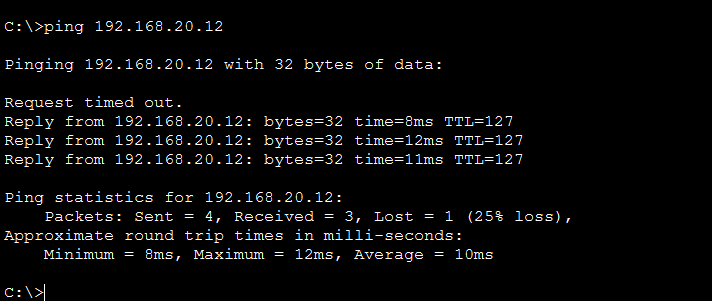
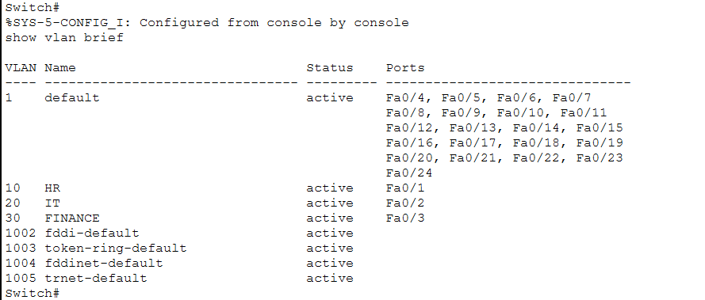
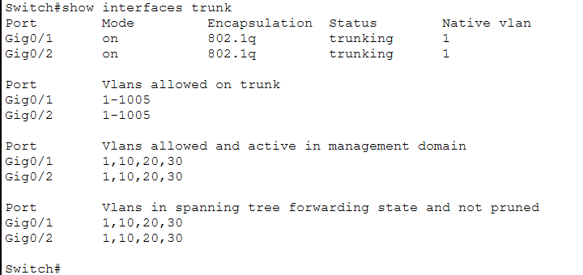
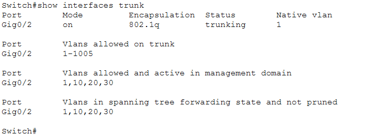
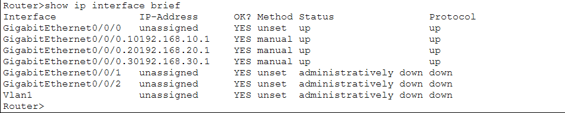

# Cisco-VLAN-InterVLAN-Routing-Project
# Secure Office Network Design and Configuration Using VLANs

## 1. Network Topology
Below is the physical layout setup of the router, switches, and distributed computers.

---

## 2. Testing and Verification

### Test A, Same vlan Communication
Computers in the same department
- ping was successful

#### Same VLAN Verification Screenshots:
* **Finance Department:**
  
* **HR Department:**
  
* **IT Department:**
  

---

### Test B, Inter vlan Communication
- Testing to see if the router is successfully passing traffic between different departments.
- First request was Request timed out as the devices were learning MAC addresses via ARP. The other 3 suceeded.

#### Inter-VLAN Verification Screenshot:

---

### Test C, vlan Isolation
- I tested this by opening the cli of the router and I wrote shutdown and answered the following questions

* **Can two PCs in the same vlan still communicate?**
  - Yes, pcs in the same vlan can still communicate with each other because their traffic is switched locally at Layer 2 by the switches without needing a router.

* **Can a PC in vlan 10 communicate with a PC in vlan 20?**
  - No, devices on different subnets require a Layer 3 gateway (the router) to move packets between the distinct networks.

* **Why does the router's availability affect communication between different vlans but not necessarily within the same vlan?**
  - Communication within the same vlan uses Layer 2 MAC addresses and stays entirely inside the local switch infrastructure. Communication between different vlans requires Layer 3 routing to cross network boundaries; therefore, if the default gateway (the router) is offline, inter-vlan traffic has no path to follow.

---

### Test D, Simulation Mode

* **How the source PC identifies its default gateway's MAC address:**
  - The source PC checks its local ARP cache. If it doesn't know it, it broadcasts an ARP Request asking "Who has IP 192.168.10.1?" The router subinterface replies with its MAC address.

* **How the Ethernet frame travels from the access switch to the router:**
  - The access switch receives the untagged frame from the PC port. As the frame is forwarded out of the trunk uplink interface towards the router, the switch adds an 802.1Q header tag (vlan 10) to the frame.

* **How the router identifies the correct outgoing interface:**
  - The router reads the 802.1Q tag to determine which virtual subinterface received the traffic. It strips the Layer 2 frame, looks at the destination IP address (192.168.30.11), and consults its routing table to find that the destination matches the network connected to subinterface G0/0/0.30.

* **What happens to the Ethernet source and destination MAC addresses when the router forwards the packet:**
  - The router completely rewrites the Layer 2 frame header. The Source MAC becomes the MAC address of the router's outgoing subinterface (G0/0/0.30). The Destination MAC changes to the hardware MAC address of the target PC (FIN-PC1).

* **Whether the source and destination IP addresses change during ordinary routing without NAT:**
  - No, the original source IP (192.168.10.11) and destination IP (192.168.30.11) remain completely unchanged from end to end.

---

## 3. Command Explanations and what each means based in this lab

### On the Switches:
* **show vlan brief**
  - Displays a concise summary of all configured vlans on the switch, their current operational status, and the specific physical access ports assigned to each vlan.
* **show interfaces trunk**
  - Shows all active trunk links on the switch, detailing the trunking mode, the encapsulation type (802.1Q), and which vlan ids are permitted to transmit traffic across the link.
* **show interfaces status**
  - Provides a high-level overview of every port on the switch, showing whether the port is connected, its operational speed, duplex settings, and the assigned vlan mode.
* **show mac address-table**
  - Displays the dynamic mapping of MAC addresses learned by the switch to their corresponding physical ports, which helps verify Layer 2 forwarding paths.
* **show running-config**
  - Displays the entire active configuration currently running in the switch's volatile RAM, allowing administrators to inspect all interface settings, passwords, and global commands.

### On the Router:
* **show ip interface brief**
  - Provides a quick summary of all physical interfaces and logical subinterfaces on the router, displaying their assigned IP addresses, layer 1 status, and layer 2 protocol status.
* **show ip route**
  - Displays the router's active routing table, which lists all directly connected networks, static routes, and dynamically learned paths used to make Layer 3 forwarding decisions.
* **show running-config**
  - Displays the current operational configuration stored in the router's RAM, showing all active interface commands, subinterface settings, and 802.1Q encapsulation bindings.
* **show interfaces**
  - Provides highly detailed operational statistics, MTU settings, error counters, and bandwidth parameters for every physical and logical interface on the router.

---

## 4. Operational Device Output Screenshots

### Switch 1 Live Verification:

### Switch 2 Live Verification:

### Router Gateway Verification:

---

## 5. Troubleshooting

* **Fault 1: Missing vlan Database on Switch 2**
  - *Description:* Initially, pcs in the HR department could not ping each other across the switches. i run show vlan brief on Switch 2, and I discovered that vlan 10, 20, and 30 had not been created locally. The switch was dropping tagged frames because it did not recognize the vlan ids.
  - *Solution:* Then I solved this by enabling and entering the global configuration mode on Switch 2 and i manually created vlan 10, 20, and 30 with their matching department names to align the databases.

* **Fault 2: Inter vlan Routing Failure Due to Dropped Trunk Native Traffic**
  - *Description:* Same-vlan communication worked perfectly, but inter-vlan pings between the HR and IT departments failed entirely and when I run show interfaces trunk on Switch 1 checking the connection link, I noticed that the router (Gig0/1) was still operating in default access mode instead of trunk mode.
  - *Solution:* Then I solved this by enabling and entering interface Gig0/1 on Switch 1 and applied the switchport mode trunk command and this allowed the interface to successfully forward multi-vlan tagged traffic upward to the router's subinterfaces.

---

## 6. Conclusion
implementing Virtual Local Area Networks, vlans improves the network organization, efficiency, and security of the office infrastructure by logically separating the HR, IT, and Finance departments. And also vlans enable network isolation, sensitive financial information and confidential employee records are completely safe from unauthorized access
